# Dynamic Multi-LoRA Hot-Swapping & CI/CD Agent Evaluation (`adk eval`) on Cloud Run GPUs with Gemma 4 & vLLM


> **Author & Architect:** [Robina Mirbahar](https://github.com/RobinaMirbahar) (Google Developer Expert in Cloud & AI)  
> **Focus:** Serving Multiple Fine-Tuned Gemma 4 LoRA Adapters on a Single Cloud Run GPU with Automated ADK Trajectory Evaluation

---

## 🎯 Why I Built Dynamic Multi-LoRA Hot-Swapping & CI/CD Agent Evaluation (`adk eval`) (Engineering Purpose & Real-World Value)

### 1. ⚡ Serving Multiple Specialized Agents on a Single GPU
Deploying separate GPU instances for SecOps, FinOps, and SQL sub-agents is prohibitively expensive. I architected dynamic Multi-LoRA hot-swapping on a single shared Gemma 4 base model in vLLM so multiple domain adapters share one Cloud Run GPU.

### 2. 🧪 Deterministic CI/CD Trajectory Gatekeeping (`adk eval`)
A fine-tuned adapter should never reach production if it breaks tool-calling schemas. I integrated Google ADK's `adk eval` into CI/CD to score tool-call trajectory accuracy and response rubrics automatically before rollout.

### 3. ☁️ Zero-Downtime Adapter Promotion on Google Cloud Run
My architecture loads new QLoRA adapters directly from Cloud Storage buckets at runtime without restarting the base vLLM container.

---

## 🏗️ System Architecture

```mermaid
flowchart TD
    subgraph Train ["1. Adapter Registry (Google Cloud Storage)"]
        L1["SecOps LoRA Adapter"]
        L2["FinOps LoRA Adapter"]
        L3["Compliance LoRA Adapter"]
    end
    subgraph Serve ["2. Shared Cloud Run L4 GPU Instance"]
        V_Base["Frozen Gemma 4 Base Weights (vLLM)"]
        V_Swap["Dynamic Per-Request LoRA Router"]
        ADK["Google ADK Multi-Agent Runner"]
    end
    subgraph Eval ["3. CI/CD Trajectory Gatekeeper"]
        E_ADK["adk eval Golden Dataset Runner"]
        E_Score["Tool Trajectory & Rubric Threshold Gate"]
    end
    L1 & L2 & L3 --> V_Swap
    V_Base --> V_Swap <--> ADK
    ADK --> E_ADK --> E_Score
```



---

Official reference repository for the hands-on Google Codelab: **Dynamic Multi-LoRA Hot-Swapping & CI/CD Agent Evaluation (`adk eval`) on Cloud Run GPUs with Gemma 4 & vLLM**.

---

## Architectural Overview

Instead of deploying three separate Cloud Run GPU services for three fine-tuned specialist agents, this architecture loads frozen open-weights **Gemma 4 (`google/gemma-4-27b-it`)** once into a single **Cloud Run NVIDIA L4 GPU** and dynamically hot-swaps lightweight rank-16 QLoRA adapters (~64.5 MB VRAM overhead each) from **Cloud Storage FUSE** (`/mnt/models/loras/*`) in under **2 milliseconds**:


Every prompt or LoRA adapter update is gated in **Google Cloud Build** using **Google ADK's evaluation framework (`adk eval`)** across two deterministic metrics before shifting production traffic:
* **`tool_trajectory_avg_score` ($\ge 0.95$):** Verifies exact tool-call sequence and JSON arguments.
* **`response_match_score` ($\ge 0.85$):** Verifies ROUGE token-level factuality against the Golden Evaluation Dataset.


---

## Project Structure

```text
gemma4-multilora-adk-eval/
├── requirements.txt
├── Dockerfile
├── .dockerignore
├── multilora_adk_eval/
│   ├── schemas.py                 # Pydantic v2 schemas for LoRA metadata & eval scores
│   ├── vllm_multilora_router.py   # Runtime LoRA hot-loader (POST /v1/load_lora_adapter)
│   ├── agent.py                   # 3-specialist Google ADK Multi-LoRA Coordinator
│   ├── golden_eval_set.json       # ADK Golden Evaluation Dataset
│   └── eval_config.json           # Release gate threshold config (0.95 / 0.85)
├── scripts/
│   └── run_multilora_adk_eval.py  # Multi-LoRA vs. Base Gemma 4 evaluation harness
└── deploy/
    ├── deploy_multilora_cloud_run.sh  # Cloud Run NVIDIA L4 GPU + GCS FUSE deployment
    └── cloudbuild_adk_eval.yaml       # 3-step Cloud Build CI/CD release gate
```

---

## Quick Start (Google Cloud Shell)

```bash
git clone https://github.com/RobinaMirbahar/gemma4-multilora-adk-eval.git
cd gemma4-multilora-adk-eval

python3 -m venv .venv
source .venv/bin/activate
pip install -r requirements.txt

# Run the Multi-LoRA vs. Base Gemma 4 ADK Evaluation Suite
python3 scripts/run_multilora_adk_eval.py
```

### Expected Output

```text
========================================================================================
[STAGE 1] Hot-Loading 3 Domain QLoRA Adapters into Shared Gemma 4 vLLM Server
========================================================================================
  [HOT-LOADED] sre-incident-lora    -> /mnt/models/loras/sre-incident-v1 (rank=16, VRAM=+64.5 MB)
  [HOT-LOADED] finops-cost-lora     -> /mnt/models/loras/finops-cost-v1 (rank=16, VRAM=+64.5 MB)
  [HOT-LOADED] secops-audit-lora    -> /mnt/models/loras/secops-audit-v1 (rank=16, VRAM=+64.5 MB)

========================================================================================
[STAGE 3] CI/CD Release Gate Verdict (adk eval)
========================================================================================
  Base Gemma 4 Tool Trajectory Avg      : 0.33 (FAIL < 0.95)
  Multi-LoRA Tool Trajectory Avg        : 1.00 (PASS >= 0.95)
  Multi-LoRA Response Factuality Avg    : 1.00 (PASS >= 0.85)
  Cloud Build Traffic Promotion Gate    : APPROVED (100% TRAFFIC)
```

---

## Cloud Shell Execution & Editor Screenshots

| Cloud Shell Editor (`vllm_multilora_router.py`) | Cloud Shell Editor (`agent.py`) |
| :---: | :---: |
|  |  |

| ADK Eval Stage 1–3 Verdict | Validated `EvalSuiteSummary` JSON |
| :---: | :---: |
|  |  |

<!-- AUTHOR_SIGNATURE_START -->
---

## 👩‍💻 About the Author

**Robina Mirbahar — Google Cloud & AI Architect**  
*Google Developer Expert (GDE) in Cloud & AI • Published Author • Multi-Agent Systems & Serverless GPU Builder*

[](https://github.com/RobinaMirbahar)
[](https://medium.com/@robinamirbahar)
[](https://dev.to/robinamirbahar)
[](https://www.linkedin.com/in/robina-mirbahar)
[](https://g.dev/RobinaMirbahar)
[](https://www.youtube.com/@RobinaMirbahar)
[](https://x.com/RobinaMirbahar)
[](https://www.amazon.com/dp/B0D146249R)

<!-- AUTHOR_SIGNATURE_END -->
