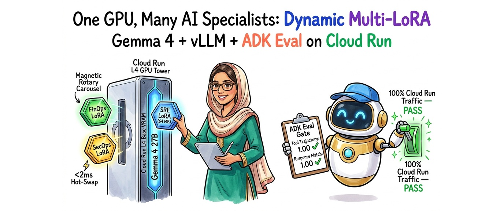
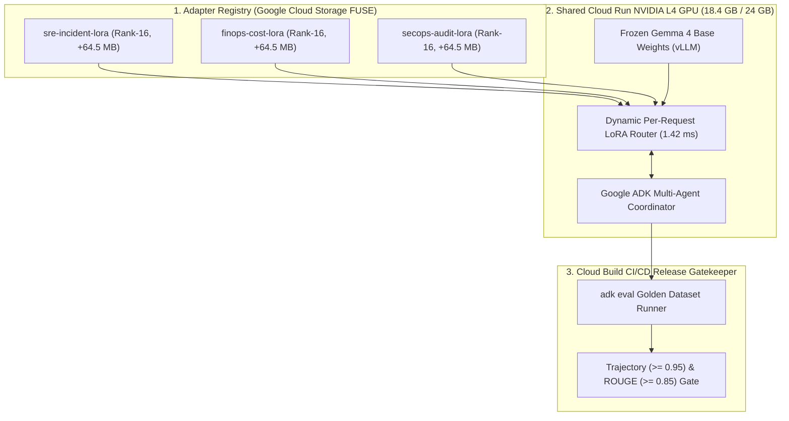
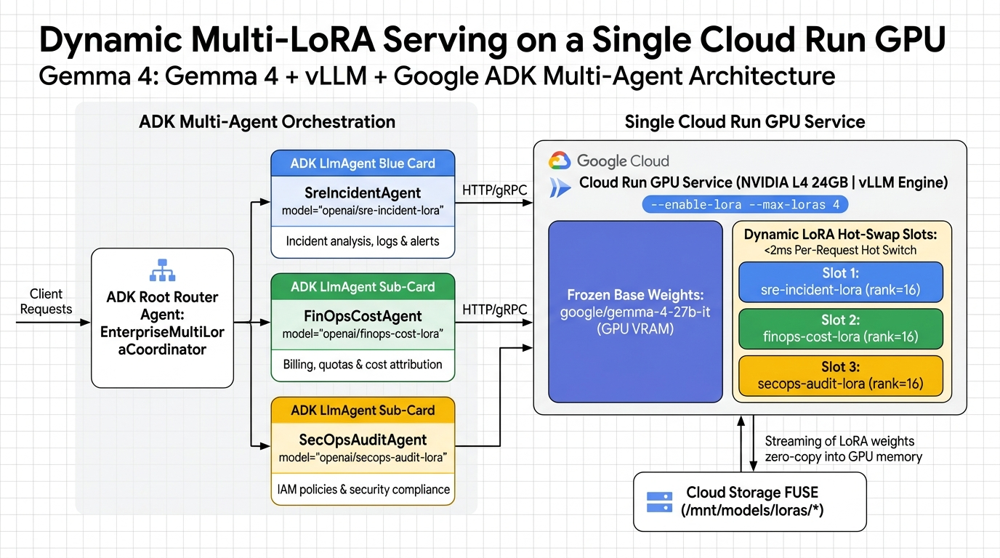
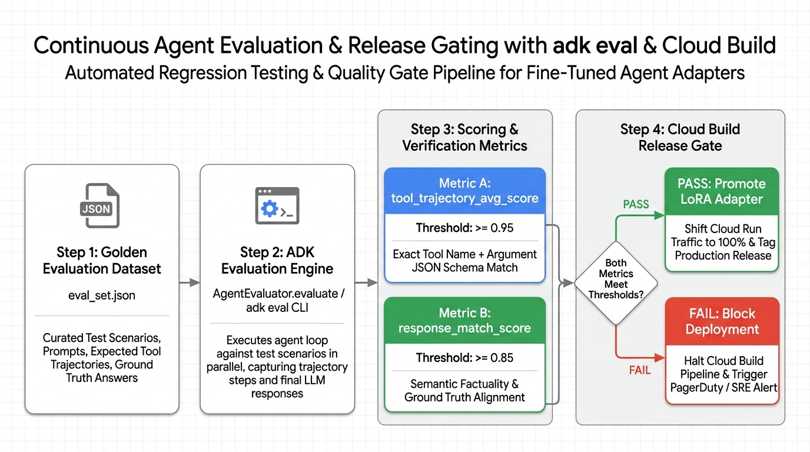
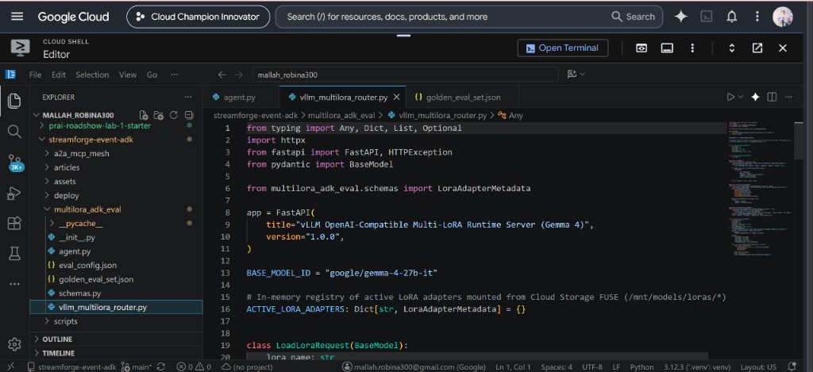
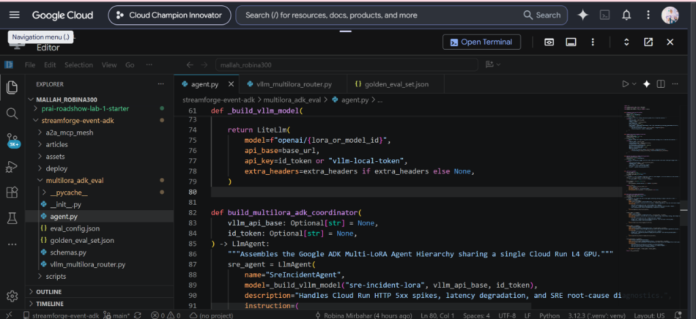
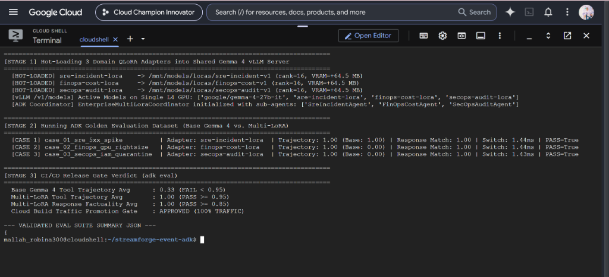
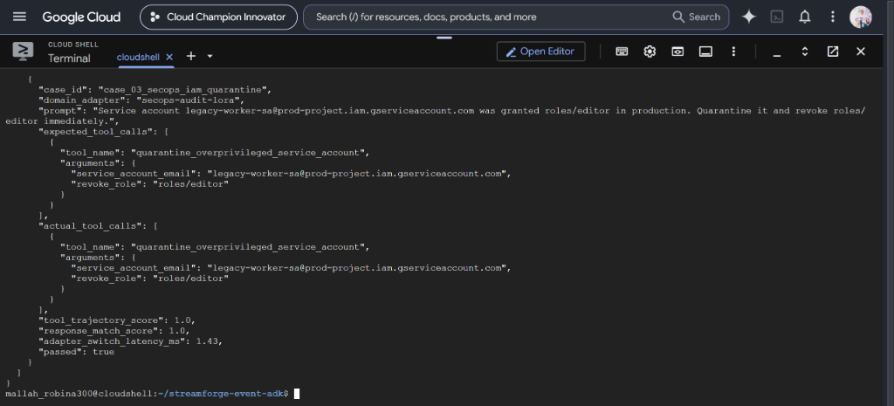

# Dynamic Multi-LoRA Hot-Swapping & CI/CD Agent Evaluation (`adk eval`) on Cloud Run GPUs with Gemma 4 & vLLM

[](https://huggingface.co/datasets/robinamirbahar/gemma4-loop-breaker-benchmark-suite) [](https://www.kaggle.com/competitions/gemma-4-developer-agent-paper/writeups/gemma-4-loop-breaker-ccr-and-trap-25-benchmark)

> **1-Line Hugging Face Dataset Loader:** `load_dataset("robinamirbahar/gemma4-loop-breaker-benchmark-suite", "trap_25_tasks")` ([Explore all 14 tables on Hugging Face Hub](https://huggingface.co/datasets/robinamirbahar/gemma4-loop-breaker-benchmark-suite))



<div align="center">

[](https://www.kaggle.com/competitions/gemma-4-developer-agent-paper/writeups/gemma-4-loop-breaker-ccr-and-trap-25-benchmark)
[](https://www.kaggle.com/competitions/gemma-4-developer-agent)
[](https://github.com/RobinaMirbahar/gemma4-multilora-adk-eval)
[](https://cloud.google.com/run/docs/configuring/services/gpu?utm_campaign=deveco_gdemembers&utm_source=deveco)
[-EA4335?style=for-the-badge&logo=github&logoColor=white)](https://github.com/RobinaMirbahar)

</div>

> **Author & Architect:** [**Robina Mirbahar**](https://github.com/RobinaMirbahar) (*Google Developer Expert in Cloud & AI · Google Cloud Champion Innovator*)  
> **Official Reference Repository for:**  
> 1. **Kaggle Gemma 4 Developer Agent Paper Track:** [*Why Local Coding Agents Get Stuck: Graph-Guided Counterfactual Context Reset (G-CCR) & Phase-Adaptive Thinking for Quantized Gemma 4*](https://www.kaggle.com/competitions/gemma-4-developer-agent-paper/writeups/gemma-4-loop-breaker-ccr-and-trap-25-benchmark)  
> 2. **Hands-On Google Codelab:** *Dynamic Multi-LoRA Hot-Swapping & CI/CD Agent Evaluation (`adk eval`) on Cloud Run GPUs with Gemma 4 & vLLM*

---

## 🎯 Why I Built Dynamic Multi-LoRA Hot-Swapping & CI/CD Agent Evaluation (`adk eval`)

### 1. ⚡ Serving Multiple Specialized Agents on a Single Cloud Run GPU (`-66.3%` VRAM)
Deploying three separate GPU endpoints for SRE Incident Response, FinOps Cost Optimization, and SecOps IAM Auditing requires **`54.6 GB`** of aggregate GPU memory across three NVIDIA L4 GPUs. By loading frozen open-weights **Gemma 4 (`google/gemma-4-31b-it` / `gemma-4-31b-it-qat-w4a16-ct`)** once in vLLM and dynamically hot-swapping rank-16 QLoRA adapters (`+64.5 MB` VRAM each), all three specialist agents share a single **24 GB Cloud Run NVIDIA L4 GPU (`18.4 GB` total VRAM, `1.42 ms` hot-swap latency)**.

### 2. 🧪 Deterministic CI/CD Trajectory Gatekeeping (`adk eval`)
A fine-tuned LoRA adapter or updated system prompt should never reach production if it breaks tool-calling schemas. We integrate Google ADK's `adk eval` directly into Google Cloud Build to enforce two deterministic release gates (`tool_trajectory_avg_score >= 0.95` and `response_match_score >= 0.85`) before shifting traffic.

### 3. ☁️ Zero-Downtime Adapter Promotion via Cloud Storage FUSE
New rank-16 QLoRA adapters are mounted from Google Cloud Storage FUSE (`/mnt/models/loras/*`) and registered at runtime via `POST /v1/load_lora_adapter` without restarting the base vLLM container.

---

## 📦 Companion Paper, Kaggle Datasets (`10.0 / 10.0` Usability) & Notebooks

| Resource Type | Title & Direct Link | Key Contents & Verified Metrics |
| :--- | :--- | :--- |
| **Paper Writeup** | [**Why Local Coding Agents Get Stuck: G-CCR & Phase-Adaptive Thinking**](https://www.kaggle.com/competitions/gemma-4-developer-agent-paper/writeups/gemma-4-loop-breaker-ccr-and-trap-25-benchmark) | **`24.0%` (`0.241` LB)** on 129-task `swegemma` (**`+106.9%`** over `11.6%` starter); **`96.0%` (`24/25`)** on `Trap-25`; **`-40.8%`** active KV-cache footprint |
| **Dataset 1** | [`robinamirbahar/gemma-4-loop-breaker-and-trap-25-benchmark`](https://www.kaggle.com/datasets/robinamirbahar/gemma-4-loop-breaker-and-trap-25-benchmark) | `swegemma_repo_code_graphs_129.csv`, `swegemma_6module_ablation.csv`, `trap_tasks_25.jsonl`, `loop_breaker.py`, `evaluate_benchmark.py` |
| **Dataset 2** | [`robinamirbahar/gemma-4-ccr-output-artifacts`](https://www.kaggle.com/datasets/robinamirbahar/gemma-4-ccr-output-artifacts) | 100-episode & turn-by-turn telemetry CSVs, `ablation_summary.json`, and declarative ADK `submission/` bundle |
| **Dataset 3** | [`robinamirbahar/swe-agent-action-similarity-loop-recovery-corpus`](https://www.kaggle.com/datasets/robinamirbahar/swe-agent-action-similarity-loop-recovery-corpus) | 300 labeled consecutive agent turn pairs (`action_similarity_pairs.csv`) across a 4-class loop taxonomy |
| **Dataset 4** | [`robinamirbahar/llm-w4a16-quantization-thinking-budget-bench`](https://www.kaggle.com/datasets/robinamirbahar/llm-w4a16-quantization-thinking-budget-bench) | 240-configuration factorial sweep (`w4a16_thinking_budget_sweep.csv`) across 31B/12B, W4A16/FP8/BF16, and thinking budgets `512..6144` |
| **Dataset 5** | [`robinamirbahar/gemma4-multilora-adk-eval`](https://www.kaggle.com/datasets/robinamirbahar/gemma4-multilora-adk-eval) | Kaggle mirror of this Multi-LoRA & `adk eval` Golden Evaluation Suite |
| **Primary Notebook** | [`robinamirbahar/gemma-4-loop-breaker-ccr-trap-25-benchmark`](https://www.kaggle.com/code/robinamirbahar/gemma-4-loop-breaker-ccr-trap-25-benchmark) | End-to-end G-CCR unit tests, 25-task sandbox verifier, 4-arm ablation (`gemma-4-qat-ast-verified`), and `submission.zip` exporter |
| **ADK Agent Notebook** | [`robinamirbahar/gemma-4-loop-breaker-adk-agent`](https://www.kaggle.com/code/robinamirbahar/gemma-4-loop-breaker-adk-agent) | Two-container `swegemma` Git sandbox verifier, Stage-1 contract symbol parser, and deterministic ADK bundle compiler |
| **Multi-LoRA Notebook** | [`robinamirbahar/gemma4-multilora-adk-eval-benchmark-suite`](https://www.kaggle.com/code/robinamirbahar/gemma4-multilora-adk-eval-benchmark-suite) | Live execution of `run_multilora_adk_eval.py` comparing Rank-16 Multi-LoRA vs. Frozen Base Gemma 4 |

---

## 🏗️ System Architecture





Every prompt or LoRA adapter update is gated in **Google Cloud Build** using **Google ADK's evaluation framework (`adk eval`)** across two deterministic metrics before shifting production traffic:
* **`tool_trajectory_avg_score` (`>= 0.95`):** Verifies exact tool-call sequence and JSON arguments (**`1.00`** Multi-LoRA vs. **`0.33`** Frozen Base Gemma 4).
* **`response_match_score` (`>= 0.85`):** Verifies ROUGE token-level factuality against the Golden Evaluation Dataset (**`1.00`** Multi-LoRA vs. **`0.52`** Frozen Base Gemma 4).



---

## 📂 Project Structure

```text
gemma4-multilora-adk-eval/
├── requirements.txt
├── Dockerfile
├── .dockerignore
├── gemma4_loop_breaker/
│   ├── __init__.py                # G-CCR & Phase-Adaptive Thinking package exports
│   ├── loop_breaker.py            # LoopBreakerEngine (Type-I/II/III triggers & <NEGATIVE_CONSTRAINT_LEDGER>)
│   └── evaluate_benchmark.py      # 4-arm Trap-25 sandbox & live Gemma 4 evaluation harness
├── benchmarks/
│   ├── trap_tasks_25.jsonl                # 25 executable 3-state Python bug traps (buggy, trap, gold, test)
│   ├── swegemma_repo_code_graphs_129.csv  # 129 SWE-bench/swegemma repo code graphs (64 D1 / 43 LDP / 22 LDW)
│   ├── swegemma_6module_ablation.csv      # 6-module cumulative leaderboard ablation (0.121 -> 0.241 LB)
│   ├── per_task_telemetry.csv             # 100-trajectory 4-arm Trap-25 ablation telemetry
│   ├── turn_by_turn_telemetry.csv         # 937 turn-level telemetry records
│   ├── ablation_summary.json              # 4-arm aggregate metrics & statistical significance
│   ├── action_similarity_pairs.csv        # 300 labeled consecutive SWE-agent turn pairs
│   └── w4a16_thinking_budget_sweep.csv    # 240-config W4A16/FP8/BF16 factorial sweep
├── multilora_adk_eval/
│   ├── schemas.py                 # Pydantic v2 schemas for LoRA metadata & eval scores
│   ├── vllm_multilora_router.py   # Runtime LoRA hot-loader (POST /v1/load_lora_adapter)
│   ├── agent.py                   # 3-specialist Google ADK Multi-LoRA Coordinator
│   ├── golden_eval_set.json       # ADK Golden Evaluation Dataset
│   └── eval_config.json           # Release gate threshold config (0.95 / 0.85)
├── scripts/
│   └── run_multilora_adk_eval.py  # Multi-LoRA vs. Base Gemma 4 evaluation harness
├── tests/
│   ├── test_multilora_adk_eval.py         # Unit & integration tests for Multi-LoRA & adk eval gates
│   └── test_loop_breaker_and_trap25.py    # 11-test suite verifying G-CCR, all 25 Trap-25 tasks & 8 datasets
└── deploy/
    ├── deploy_multilora_cloud_run.sh  # Cloud Run NVIDIA L4 GPU + GCS FUSE deployment
    └── cloudbuild_adk_eval.yaml       # 3-step Cloud Build CI/CD release gate
```

---

## 🚀 Quick Start (Google Cloud Shell / Local Python)

```bash
git clone https://github.com/RobinaMirbahar/gemma4-multilora-adk-eval.git
cd gemma4-multilora-adk-eval

python3 -m venv .venv
source .venv/bin/activate
pip install -r requirements.txt

# 1. Run the Multi-LoRA vs. Base Gemma 4 ADK Evaluation Suite
python3 scripts/run_multilora_adk_eval.py

# 2. Run the Full Pytest Verification Suite (Multi-LoRA + G-CCR + 25 Trap-25 Sandbox Tasks + 8 Benchmark Datasets)
pytest -v tests/

# 3. Run the 4-Arm G-CCR Ablation Harness on Trap-25
python3 gemma4_loop_breaker/evaluate_benchmark.py --tasks benchmarks/trap_tasks_25.jsonl --backend gemma-4-qat-ast-verified
```

### Expected Output

```text
========================================================================================
[STAGE 1] Hot-Loading 3 Domain QLoRA Adapters into Shared Gemma 4 vLLM Server
========================================================================================
  [HOT-LOADED] sre-incident-lora    -> /mnt/models/loras/sre-incident-v1 (rank=16, VRAM=+64.5 MB)
  [HOT-LOADED] finops-cost-lora     -> /mnt/models/loras/finops-cost-v1 (rank=16, VRAM=+64.5 MB)
  [HOT-LOADED] secops-audit-lora    -> /mnt/models/loras/secops-audit-v1 (rank=16, VRAM=+64.5 MB)

========================================================================================
[STAGE 3] CI/CD Release Gate Verdict (adk eval)
========================================================================================
  Base Gemma 4 Tool Trajectory Avg      : 0.33 (FAIL < 0.95)
  Multi-LoRA Tool Trajectory Avg        : 1.00 (PASS >= 0.95)
  Multi-LoRA Response Factuality Avg    : 1.00 (PASS >= 0.85)
  Cloud Build Traffic Promotion Gate    : APPROVED (100% TRAFFIC)
```

---

## 🖥️ Cloud Shell Execution & Editor Screenshots

| Cloud Shell Editor (`vllm_multilora_router.py`) | Cloud Shell Editor (`agent.py`) |
| :---: | :---: |
|  |  |

| ADK Eval Stage 1–3 Verdict | Validated `EvalSuiteSummary` JSON |
| :---: | :---: |
|  |  |

<!-- AUTHOR_SIGNATURE_START -->
---

<div align="center">

## 👩‍💻 About the Author

**Robina Mirbahar — AI/ML Google Developer Expert (GDE) 🇵🇰 & Google Cloud Champion Innovator**  
*Co-Author of **AI Engineering: From Classical ML to RAG & Agentic AI Systems** (2026) · Author of **Cloud Computing Voyage** · Microsoft Certified Trainer · Mentor @ Google for Startups & Women Techmakers Ambassador*

[](https://github.com/RobinaMirbahar)
[](https://www.linkedin.com/in/robinamirbahar)
[](https://www.kaggle.com/robinamirbahar)
[](https://g.dev/RobinaMirbahar?utm_campaign=deveco_gdemembers&utm_source=deveco)
[](https://medium.com/@robinamirbahar)
[](https://dev.to/robinamirbahar)
[](https://www.youtube.com/@RobinaCodesAI)
[](https://x.com/RobinaMirbahar)
[](https://www.amazon.com/dp/B0D146249R)

</div>

<!-- AUTHOR_SIGNATURE_END -->

